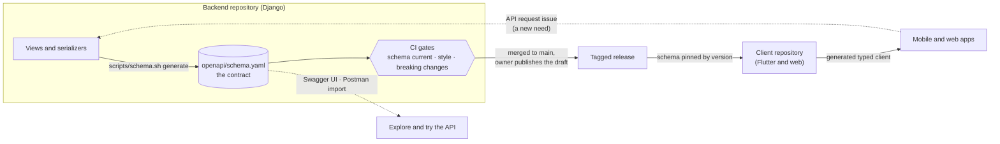
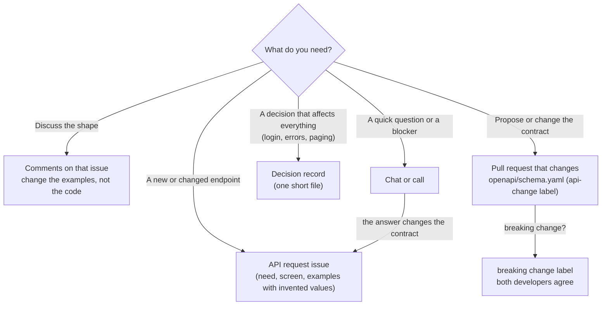
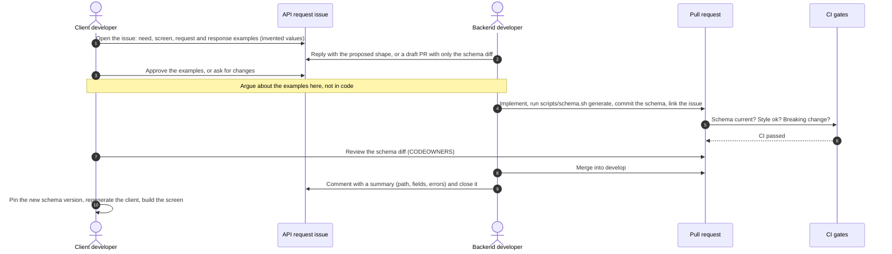
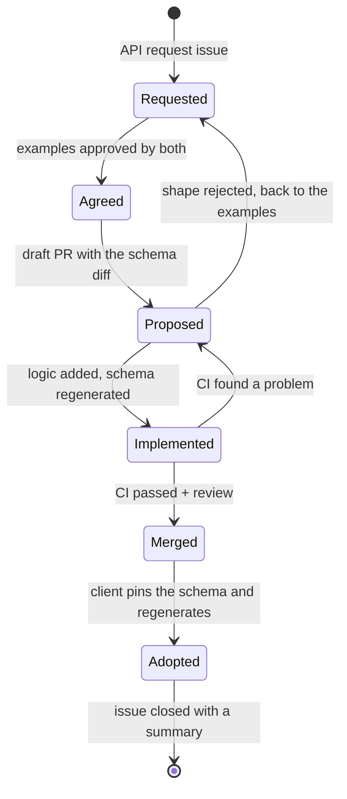

# API collaboration: how the backend and client developers work together

This is the working agreement for a project with **one backend developer** (Django) and **one
client developer** (Flutter and web). It explains the strategy, who decides what, which channel
carries which kind of message, and which tools help. The mechanics (issue form, CI gates, labels)
are in [`api-workflow.md`](api-workflow.md); the response and URL defaults are in
[`api-conventions.md`](api-conventions.md).

## The five rules

1. **One contract.** `openapi/schema.yaml` is the only description of the API. It is generated
   from the code and committed; nobody edits it by hand.
2. **Agree, then build.** The shape of an endpoint is agreed in writing, with examples, before
   the logic is written.
3. **Everything that changes the contract is a pull request** that touches `openapi/schema.yaml`,
   reviewed by the other developer.
4. **Machines check the boring parts.** CI proves the schema is current, well formed and not
   breaking; people review meaning, not formatting.
5. **Decisions live in writing**, in an issue, a pull request or a decision record, never only in chat.

## The picture

## Roles

| Role | Owns | Decides |
| --- | --- | --- |
| **Backend developer** | the Django code, the schema, the staging data | how an endpoint is implemented, the database, performance |
| **Client developer** | the Flutter and web apps, the generated client | what the screens need, how responses are used |
| **Both** | `openapi/schema.yaml` (both are CODEOWNERS of `/openapi/`) | the shape of every endpoint, in the issue; breaking changes, together |

With two people there is no separate owner: a **breaking change needs both to agree** and carries
the `breaking change` label (CI does not pass without it).

## How you talk: the right channel for each message

| Message | Where it goes | Why |
| --- | --- | --- |
| "I need an endpoint for screen X" | **API request** issue | one place to find the need, the examples and the outcome |
| "What should the error look like?" | comment on the issue | the answer stays next to the request |
| "Here is the proposed shape" | draft pull request containing only the schema change | the other developer approves the diff before any logic exists |
| "This will break the current app" | pull request with the `breaking change` label | CI forces the conversation |
| "We always do X" | decision record in `docs/adr/` (create the folder with the first record) | so nobody has to remember why |
| Quick clarification | chat or a call | but write the result back to the issue if it changes anything |

## The loop

## The life of one change to the contract

## Compatibility rules by phase

You have no published app yet, so the rules start light and tighten at the first release.

| Phase | What may change | Rule |
| --- | --- | --- |
| **Before the first release** | anything | A breaking change is allowed with the `breaking change` label and both developers' agreement. Prefer to get the shape right early. |
| **After the first release** | additions only, by default | Add new fields, paths and optional parameters. To change or remove something: **add the new one, move the clients over, remove the old one later** (expand, then contract). |
| **Removing something published** | only after a notice | Mark the operation `deprecated`, announce the removal date in the issue and the release notes, and send `Deprecation` and `Sunset` response headers. A mobile app cannot be forced to update, so leave the old behaviour until the app version that needs it is no longer in use. |

Breaking means an existing client can stop working: removing or renaming a path, field or enum
value, making an optional field required, narrowing a type or changing a status code.

## Ready and done

A backend task is **ready** when the issue has examples both developers approved.
It is **done** when:

- the schema is regenerated and committed in the same pull request;
- **CI passed** is green, and the other developer reviewed the schema diff;
- the issue has a closing comment: the path, the fields, the error cases, and anything that differs from the request.

A client task is **ready** when the schema containing the endpoint is merged (or the draft pull
request's schema diff is approved, so the client can start on the agreed types). It is **done** when the
app builds against a **pinned** schema version, not against whatever the backend currently runs.

## Tools

Everything here is free or open source. Prices and limits change, so check the vendor's page before relying on a limit.

| Need | Tool | Status in this template |
| --- | --- | --- |
| The contract | OpenAPI 3 from `drf-spectacular` | **available**: `scripts/schema.sh` |
| Style, breaking changes | Spectral, oasdiff | **available**: CI jobs, run as pinned containers |
| Request and review | issue form, pull request template, CODEOWNERS | **available** |
| Interactive docs (Swagger UI) | a static page built from the schema | *planned*: published to GitHub Pages (free for public repositories) or Cloudflare Pages (free; works for private repositories) |
| Postman | import `openapi/schema.yaml`; commit environment files with invented values | *planned*; the contract is in git, so nothing depends on a shared workspace. Postman's free-plan limits have changed repeatedly: check postman.com/pricing |
| Test the real API against the schema | Schemathesis | optional; recommended once real endpoints exist |
| The contract for the client | `openapi.yaml`, attached to every published project release (drafts are visible to maintainers only) | **available**: see [`consuming-the-api.md`](consuming-the-api.md) |
| Client code | `swagger_parser` for Flutter; `openapi-typescript` and `openapi-fetch` (or Orval) for the web | **available**: the same guide; try the one you prefer on your real schema first |
| A shared staging backend | run the backend locally with Docker (free), or a free tier such as Render with a Neon database (cold starts; check the current limits) | optional |

## Rituals

- **Weekly, 15 minutes:** open API requests, anything about to break, anything deprecated, anything
  that is blocking the other developer.
- **Every pull request that changes the schema:** the other developer reviews the diff. CODEOWNERS
  requests that automatically.
- **When you disagree:** write both options with examples in the issue, set a time limit, decide
  together, record the decision in the issue.

## Habits that keep it working

- **Invented data only** in issues, examples, seeds and test accounts. Never copy real data.
- **Regenerate before you commit.** CI fails if the committed schema differs from the code.
- **Pin the schema** the client builds against; upgrade it in a deliberate pull request.
- **Don't fix the contract in the client.** If the response is awkward, change the contract through
  the loop above.
- **Don't change the schema file by hand.** Change the code and regenerate.
